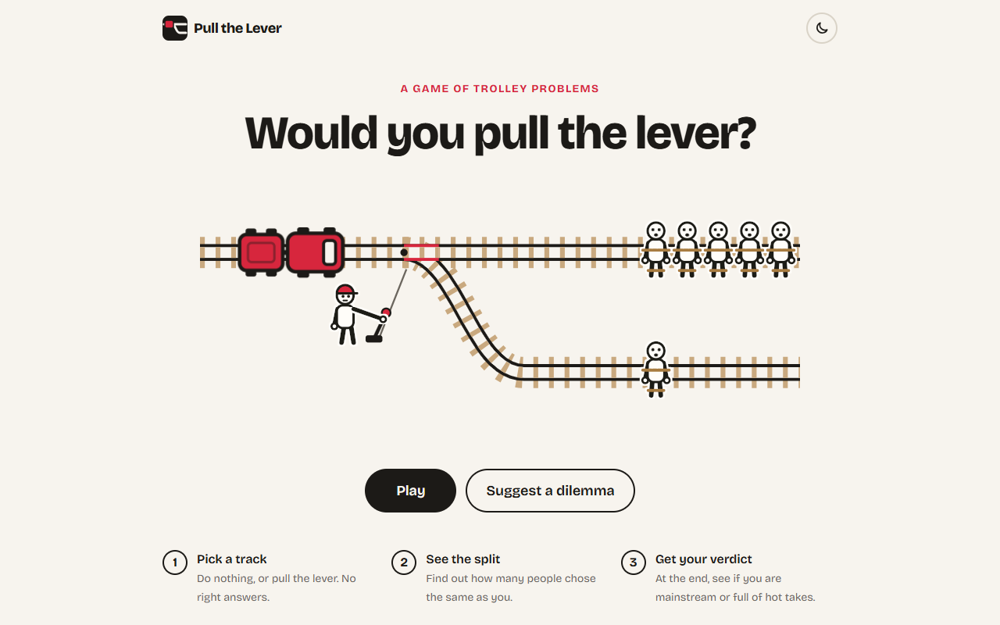
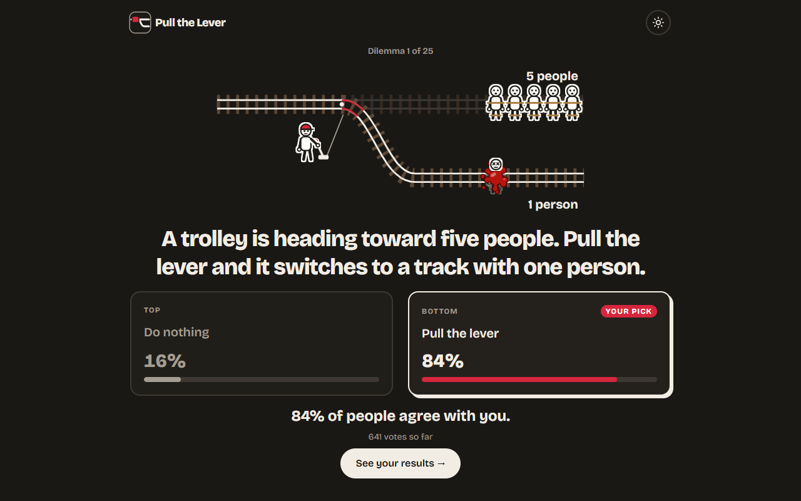
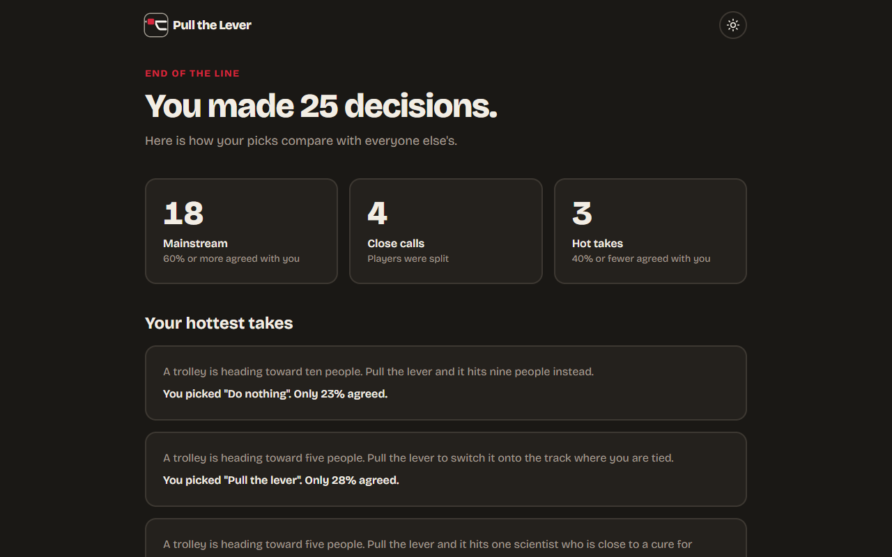

# Pull the Lever

A game of trolley problems, inspired by [Absurd Trolley Problems](https://neal.fun/absurd-trolley-problems/). The starter set has 25 serious ones: the classics, such as the switch, the loop and the trapdoor, and variants that ask who you would save.

Every dilemma has the same two answers: **Do nothing** or **Pull the lever**. If you do nothing, the trolley goes straight on. If you pull, it takes the side track. Each track shows who is on it: 1 to 5 people tied across the rails and a short label, for example "5 strangers" or "Your child". Point at an answer, and the people on its track grow a little, so you see who would die.

You pick an answer. If you pull the lever, the operator next to the track pulls it and the switch moves. Then the trolley and its wagon run over the people on that track (cartoon blood and X eyes) and drive off, and you see how many other players chose the same. At the end you get your verdict: how many of your picks were mainstream, close calls or hot takes.

The game is closed: only the admin adds dilemmas. Players can send ideas through a suggestion box, and the admin reads them on the admin page.

The game has a light and a dark mode. It follows the device setting, and a button in the top corner switches it.



| A vote and its results (dark mode)                             | The end screen                                        |
| -------------------------------------------------------------- | ----------------------------------------------------- |
|  |  |

## Stack

- **Client:** React, Vite, Tailwind CSS, React Router
- **Server:** Express 5 JSON API, Sequelize, SQLite
- **Tests:** Vitest and Supertest (API tests)
- **Code checks:** ESLint and Prettier

Players do not log in. Each browser gets a random player ID in a cookie, and votes are saved under that ID. Only the admin logs in, with a password from `.env`.

## Get started

You need Node.js 22 or newer.

1. Install the packages:

   ```bash
   npm install
   ```

2. Copy `.env.example` to `.env`. Fill in `ADMIN_PASSWORD` and `JWT_SECRET`. The other settings are optional:
   - `PORT`: the API port. The default is 3000.
   - `DATABASE_FILE`: where the SQLite file goes, from the `server` folder. The default is `data/game.db`.
   - `TRUST_PROXY`: set it to 1 behind a hosting proxy. See [Security](#security).

3. Add the starter dilemmas to the database:

   ```bash
   npm run seed
   ```

4. Start the server and the client:

   ```bash
   npm run dev
   ```

5. Open http://localhost:5173.

The admin page has no link in the game. Open http://localhost:5173/admin and log in with `ADMIN_PASSWORD`. There you can:

- Add a dilemma: write the text, then say who is on the "do nothing" track and on the "pull the lever" track.
- Read the players' suggestions, and mark each one as done.
- Delete a dilemma from the game. This also deletes its votes.

## Commands

Run these from the project root.

| Command          | What it does                                                  |
| ---------------- | ------------------------------------------------------------- |
| `npm run dev`    | Starts the API on port 3000 and the client on port 5173.      |
| `npm run seed`   | Adds the starter dilemmas, but only if the database is empty. |
| `npm test`       | Runs the API tests on a separate database in memory.          |
| `npm run build`  | Builds the client into `client/dist`.                         |
| `npm start`      | Starts the server. It also serves `client/dist` if it exists. |
| `npm run format` | Formats every file with Prettier.                             |
| `npm run lint`   | Checks the code for likely bugs with ESLint.                  |

To run it in production: run `npm run build`, then `npm start`, with `NODE_ENV=production`. Then one server on one port serves both the API and the game.

The server creates missing tables at start-up, but it does not add new columns to tables that already exist. After a change to a model in `server/src/models/`, delete the database file (`server/data/game.db`) and run `npm run seed` again. This deletes all votes, suggestions and dilemmas that you added on the admin page.

## Project structure

```
client/                 React app
  src/api.js            Every call to the API
  src/limits.js         Copy of the server's text limits
  src/pages/            One file for each page (Home, Play, Suggest, Admin)
  src/components/       Shared parts: layout, track drawing, option cards, end screen
server/                 Express API
  src/app.js            Routes and middleware
  src/server.js         Starts the server
  src/config.js         Every setting from .env
  src/models/           Dilemma, Option, Vote and Suggestion tables
  src/routes/           One file for each group of endpoints
  src/services/         Game logic: dilemmas, votes and results, suggestions
  src/db/dilemmas.json  The starter dilemmas
  test/                 API tests
docs/screenshots/       Images for this README
IDEAS.md                Ideas for later
```

## API

All endpoints start with `/api`. Errors come back as `{ "error": "message" }`.

| Method | Path                     | What it does                                                       |
| ------ | ------------------------ | ------------------------------------------------------------------ |
| GET    | `/dilemmas`              | Lists every dilemma, with the option this player picked.           |
| POST   | `/dilemmas/:id/votes`    | Saves a vote: `{ "optionId": 1 }`. Returns the results.            |
| GET    | `/players/me/summary`    | Shows how often this player agreed with everyone else.             |
| POST   | `/suggestions`           | Sends an idea for a dilemma: `{ "text": "..." }`, up to 300 chars. |
| POST   | `/admin/login`           | Logs in as admin: `{ "password": "..." }`.                         |
| POST   | `/admin/logout`          | Logs out.                                                          |
| GET    | `/admin/session`         | Returns `{ "isAdmin": true }` or `{ "isAdmin": false }`.           |
| POST   | `/admin/dilemmas`        | Admin only. Adds a dilemma. See the body below.                    |
| DELETE | `/admin/dilemmas/:id`    | Admin only. Deletes a dilemma and its votes.                       |
| GET    | `/admin/suggestions`     | Admin only. Lists the players' suggestions, oldest first.          |
| DELETE | `/admin/suggestions/:id` | Admin only. Deletes a suggestion when the admin is done with it.   |

A player can vote only once on each dilemma. A second vote keeps the first answer.

A new dilemma has its text and who is on each track. Each track needs a `trackLabel` (up to 30 characters) and `peopleOnTrack` (1 to 5). The server adds the two answers itself.

```json
{
  "text": "A trolley is heading toward five people. Pull the lever and it hits one person instead.",
  "doNothing": { "trackLabel": "5 people", "peopleOnTrack": 5 },
  "pullTheLever": { "trackLabel": "1 person", "peopleOnTrack": 1 }
}
```

## Results

A pick counts once its dilemma has at least 5 votes:

- **Mainstream:** 60% or more of players agreed.
- **Close call:** between 41% and 59% agreed.
- **Hot take:** 40% or fewer agreed.

## Security

- The admin password and the JWT secret come from `.env`. The server does not start without them.
- The admin login token is kept in an httpOnly cookie, so page scripts cannot read it. It expires after 8 hours.
- Rate limits count requests per IP address:
  - Admin login: 5 failed attempts per 15 minutes.
  - Suggestions: 10 per hour.
- The limits are kept in memory, so they reset when the server restarts.
- Behind a hosting proxy, every request seems to come from the proxy's IP address. Then one person can use up a limit for everyone. Set `TRUST_PROXY=1` in `.env` when you deploy, so the limits see each player's real IP address.
- The server sends security headers with [helmet](https://helmetjs.github.io/), for example a Content Security Policy.
